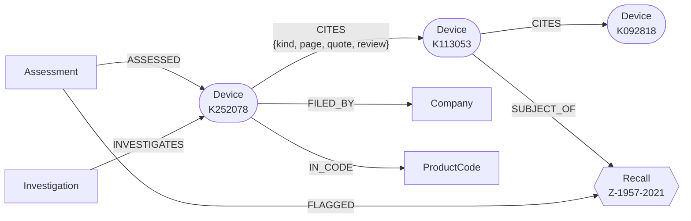
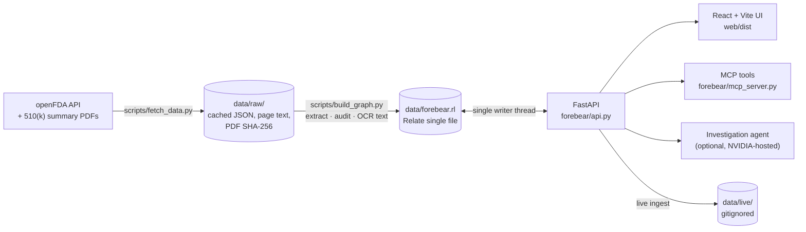

<div align="center">



<br/>

[](https://youtu.be/wi9gg9Cik7Y)
[](https://devpost.com/software/forebear)
<br/>
[](https://github.com/Asembris/Forebear/actions/workflows/backend.yml)
[](https://github.com/Asembris/Forebear/actions/workflows/frontend.yml)
[](https://github.com/Asembris/Forebear/actions/workflows/security.yml)
[](https://github.com/Asembris/Forebear/actions/workflows/hygiene.yml)
[](https://github.com/Asembris/Forebear/actions/workflows/codeql.yml)
<br/>
[](#why-relate)
[](requirements.txt)
[](data/PROVENANCE.md)
[](LICENSE)

**[The discovery](#the-discovery)** · **[One hop](#one-hop-breathepal)** · **[Judge walkthrough](#judge-walkthrough)** · **[Why Relate](#why-relate)** · **[Architecture](#architecture)** · **[Results](#results-honestly)** · **[Docs](#go-deeper)** · **[Licensing](#data-licensing-and-attribution)**

</div>

<br/>

A new medical device reaches the US market through a 510(k) by claiming it is "substantially equivalent" to an older one, its **predicate**. That predicate was cleared against its own predicate, and so on back. FDA's databases answer one hop at a time. **Forebear reads the predicate citations out of FDA 510(k) summaries, stores the device family tree in a [Relate](https://github.com/relatedb/relate) graph joined to FDA recall records, and answers in one query whether a candidate predicate, or any of its ancestors, was recalled for a design problem.** Every link carries the PDF page and the quote it came from.

> [!IMPORTANT]
> Forebear reports documented lineage and recall history. It is not regulatory advice and does not judge device safety.

## The discovery

**One more generation changes the verdict.** SleepRes PAP System (K251770) was cleared in December 2025. Its FDA summary names one predicate, the Philips DreamStation 2 (K200480), and no recall in the shipped FDA records lists the DreamStation 2. A check that stops at the named predicate comes back clean. One generation further, the DreamStation 2's own summary names two REMstar clearances, and FDA lists both on **Class I** recall **Z-1974-2021**, root cause **Device Design** (the PE-PUR foam recall), initiated **4 years 6 months** before SleepRes was cleared.

| Query depth | What it walks | Verdict for K251770 |
| --- | --- | --- |
| **1 generation** | K251770 → K200480 (no recall on file) | `NO_DESIGN_RECALL_SIGNAL`, marked **provisional** because grand-predicates were not traversed |
| **2 generations** | K251770 → K200480 → K130077 and K131982, both on Z-1974-2021 | `REVIEW_LINEAGE`, evidence complete |

**The decision it changes.** At depth 1 the result is a provisional "no design-recall signal": an engineer who took it at face value would cite the DreamStation 2 with nothing to explain. At depth 2 the verdict is **Review lineage** with complete evidence: the predicate rationale now has to account for a Class I design recall two generations up, for example by saying whether the recalled design element is carried forward, or by choosing another predicate. Forebear does not answer that question; it makes sure it gets asked, with the evidence attached.

| | Evidence | Source |
| --- | --- | --- |
| **Candidate** | K251770 · SleepRes PAP System · Sleepres, Inc. · cleared 2025-12-15 | [FDA summary PDF](https://www.accessdata.fda.gov/cdrh_docs/pdf25/K251770.pdf#page=5) |
| **Hop 1** | p. 5: *"Predicate Device: Philips DreamStation 2 - K200480"* | same PDF, page 5 |
| **Predicate** | K200480 · DreamStation 2 System · Respironics · cleared 2020-07-10 | [FDA summary PDF](https://www.accessdata.fda.gov/cdrh_docs/pdf20/K200480.pdf#page=4) |
| **Hop 2** | p. 4: *"Primary Predicate Device: REMSTAR AUTO A-FLEX HT (K131982)"*, *"Secondary Predicate Device: REMSTAR SE (K130077)"* | K200480 PDF, page 4 |
| **Recall** | Z-1974-2021 · event 88058 · Class I · Device Design · initiated 2021-06-14 (PE-PUR foam). FDA's record lists K130077 and K131982, not K200480 | [FDA recall Z-1974-2021](https://www.accessdata.fda.gov/scripts/cdrh/cfdocs/cfRES/res.cfm?id=187815) |
| **Verdict** | `REVIEW_LINEAGE` at depth 2, provisional `NO_DESIGN_RECALL_SIGNAL` at depth 1 | deterministic rules in [`forebear/lineage.py`](forebear/lineage.py) |

The recall began after the DreamStation 2 was cleared. The investigation page shows both depths side by side (*Why the graph matters*), with each hop's quote, a link to the FDA PDF at the cited page, and the recall record. In Relate the difference between the two answers is one number in the pattern, `*1..1` versus `*1..2`:

```cypher
MATCH path = (d:Device {k: 'K251770'})-[:CITES*1..2]->(a:Device)
WHERE all(c IN relationships(path) WHERE c.kind = 'predicate')
MATCH (a)-[:SUBJECT_OF]->(r:Recall)
WHERE r.classification = 'Class I' AND r.root_cause = 'Device Design'
  AND r.initiated < d.decision_date
RETURN [n IN nodes(path) | n.k] AS chain, r.id AS recall, r.initiated AS initiated
```

```text
*1..1   (no rows)
*1..2   ['K251770', 'K200480', 'K131982']  Z-1974-2021  2021-06-14
        ['K251770', 'K200480', 'K130077']  Z-1974-2021  2021-06-14
```

Every value here, including both verdicts and both query results, is asserted against the shipped store and the cached FDA page text by [`tests/test_two_hop_story.py`](tests/test_two_hop_story.py). The query is simplified: the app's version also applies human-review and audit rules to every edge (`LINEAGE_EDGE` in [`forebear/graph.py`](forebear/graph.py)). FDA attributes the recall to product families that list these clearances; it is a question for the predicate rationale, not a finding that SleepRes is unsafe.

**Why it matters.** FDA's September 2023 draft guidance on [selecting a predicate device](https://www.fda.gov/regulatory-information/search-fda-guidance-documents/best-practices-selecting-predicate-device-support-premarket-notification-510k-submission) recommends predicates without design-related recalls. That recommendation is about the predicate itself; a recall two generations up is not a guidance violation, but it is the kind of history a reviewer may ask about. [Kadakia et al. (JAMA 2023)](https://pubmed.ncbi.nlm.nih.gov/36625810/) found that devices cleared using predicates with Class I recalls had a 6.4× higher risk (RR 6.40, 95% CI 3.59–11.40) of a Class I recall of their own. Forebear is for the regulatory or quality engineer who has to check that before citing a predicate.

## One hop: BreathePal

BreathePal Bilevel (K252078, the case in the banner above) is the simpler version: the recall sits on the named predicate itself, so a one-hop lookup already finds it. It was cleared in March 2026, and its FDA summary names one predicate, the Philips Respironics BiPAP A30. FDA had already attributed a **Class I** recall with root cause **Device Design** (the same PE-PUR foam recall) to that predicate's clearance, **4 years 9 months earlier**. BreathePal's own 510(k) record does not mention it; connecting the two takes the citation on page 6 of its summary and FDA's recall records:

| | Evidence | Source |
| --- | --- | --- |
| **Candidate** | K252078 · BreathePal Bilevel · Compal Electronics · cleared 2026-03-17 | [FDA summary PDF](https://www.accessdata.fda.gov/cdrh_docs/pdf25/K252078.pdf#page=6) |
| **Citation** | p. 6: *"substantially equivalent to the legally marketed predicate device, BiPAP A30 Ventilatory support system (K113053)."* | same PDF, page 6 |
| **Predicate** | K113053 · BiPAP A30 · Respironics · cleared 2012-02-01 | [FDA 510(k) record](https://www.accessdata.fda.gov/scripts/cdrh/cfdocs/cfpmn/pmn.cfm?ID=K113053) |
| **Recall** | Z-1957-2021 and Z-1958-2021 · event 88071 · Class I · Device Design · initiated 2021-06-14 | FDA recall [Z-1957-2021](https://www.accessdata.fda.gov/scripts/cdrh/cfdocs/cfRES/res.cfm?id=187817), [Z-1958-2021](https://www.accessdata.fda.gov/scripts/cdrh/cfdocs/cfRES/res.cfm?id=187818) |
| **Verdict** | `REVIEW_LINEAGE`: a direct predicate with a Class I design recall on file | deterministic rules in [`forebear/lineage.py`](forebear/lineage.py) |

Every value in this table is asserted against the shipped store by [`tests/test_story_facts.py`](tests/test_story_facts.py) and [`tests/test_shipped_evidence.py`](tests/test_shipped_evidence.py). FDA attributes these recalls to product *families* that list K113053, so the signal is "FDA links a Class I design recall to the predicate's clearance", not "this exact model was recalled".

## Judge walkthrough

Prefer to watch first? The [demo video](https://youtu.be/wi9gg9Cik7Y) shows Forebear running, and the [Devpost submission](https://devpost.com/software/forebear) has the project write-up.

No API key, external database or other service is needed: the graph (`data/forebear.rl`) and the web build (`web/dist`) are committed, so nothing is fetched from FDA at run time. Pick one way to run it.

| Path | You need | Tested on |
| --- | --- | --- |
| Docker (recommended on macOS and Linux) | Docker Engine with Compose v2, e.g. Docker Desktop | Linux container |
| Native Windows | PowerShell 5.1+, Python 3.12, internet for the one-time `pip install` | Windows 10, Python 3.12.0 |
| Native Linux | Python 3.12 with `venv` | CI runs the test suite on Ubuntu; the app itself is demoed on Windows and in Docker |

Node is not needed unless you change the UI.

**With Docker (any OS).**

```sh
git clone https://github.com/Asembris/Forebear.git
cd Forebear
docker compose up --build
```

Open <http://localhost:8765> once the log shows `Application startup complete` (the first build downloads the Python base image and pinned dependencies; later starts take seconds). The container runs FastAPI, embedded Relate and the prebuilt UI. On first launch it copies the shipped `data/forebear.rl` into the `forebear-data` Docker volume and works on that copy, so reviews, saved assessments, investigations and ingested clearances survive `docker compose down` and restarts, while the committed evidence in the image stays untouched. `docker compose down -v` deletes the volume and starts over from the shipped store; do that after pulling a newer `data/forebear.rl`, since an existing volume is never overwritten. The port is bound to `127.0.0.1` only; the container runs as a non-root user on a read-only filesystem with all capabilities dropped, and `docker compose ps` shows its health check.

**Natively on Windows.** PowerShell, Python 3.12, no network needed after the install.

```powershell
git clone https://github.com/Asembris/Forebear.git
cd Forebear
powershell -ExecutionPolicy Bypass -File .\run.ps1
```

`run.ps1` creates `.venv`, installs the pinned [`requirements.txt`](requirements.txt), rebuilds `data\forebear.rl` offline only if it is missing, and opens <http://127.0.0.1:8765>.

**Natively on Linux.** The same steps by hand:

```sh
git clone https://github.com/Asembris/Forebear.git
cd Forebear
python3.12 -m venv .venv
.venv/bin/python -m pip install -r requirements.txt
.venv/bin/python -m uvicorn forebear.api:app --host 127.0.0.1 --port 8765
```

**Check it is up.** <http://127.0.0.1:8765/api/health> returns `{"ok": true, ...}` with the store's node and relationship counts. If it does not:

| Symptom | Fix |
| --- | --- |
| Port 8765 already in use | Native: pass another `--port`. Docker: change the left side of `127.0.0.1:8765:8765` in [`compose.yaml`](compose.yaml) |
| `Python 3.12 was not found` | Install 3.12 from [python.org](https://www.python.org/downloads/); `relate-db` 1.0.2 is pinned and tested on 3.12 |
| `run.ps1 cannot be loaded` | Use the exact command above; `-ExecutionPolicy Bypass` applies to that one process only |
| Docker shows old data after a pull | `docker compose down -v`, then `docker compose up --build` (this deletes your local reviews and saved assessments) |

Then, with any setup, in about three minutes:

1. **See what one more hop finds.** Open [`#/check/K251770`](http://127.0.0.1:8765/#/check/K251770), or click **Two hops deep** under the landing-page hero. *Why the graph matters* puts depth 1 (**No design-recall signal · provisional**) next to depth 2 (**Review lineage**, Class I design recall Z-1974-2021), with a PDF link at the cited page for each hop.
2. **Watch the thread.** The landing page opens with a short film that follows the one-hop case, K252078 → K113053 → the 2021 Class I recall (Skip or Esc ends it). Deep link: [`#/check/K252078`](http://127.0.0.1:8765/#/check/K252078).
3. **Investigate K252078.** The verdict is **Review lineage**. Open the evidence graph or its *Timeline* mode: the recall diamonds sit *before* BreathePal's clearance.
4. **Open the evidence.** Select any thread for its verbatim quote, a link to the FDA PDF at the cited page, and the PDF's SHA-256. *What needs human review* lists every uncertainty.
5. **Write to the graph.** Click **Save assessment to graph**. Under *What K252078 cites*, reject the edge: the lineage and verdict change at once and the saved assessment is marked **stale**. Restore it.
6. **Trace recall reach.** Open **Recall reach** for [`88058,88071`](http://127.0.0.1:8765/#/reach/88058,88071), the Philips recall filed as two openFDA events: 14 recalled clearances, 26 later devices descend from them, 8 of those were cleared after the recall on their own lineage began.
7. **Optional, needs internet.** **Add a clearance** fetches an out-of-family ancestor's summary from FDA into `data/live/` and extends the tree.

<details>
<summary><b>Manual setup, checks and the browser suite</b></summary>

```powershell
py -3.12 -m venv .venv
.venv\Scripts\python.exe -m pip install -r requirements.txt
.venv\Scripts\python.exe -m uvicorn forebear.api:app --port 8765
```

| Check | Command |
| --- | --- |
| Tests | `.venv\Scripts\python.exe -m pytest` |
| Lint (ruff 0.17.6, not in `requirements.txt`) | `ruff check .` |
| Offline graph rebuild, ~4 s | `.venv\Scripts\python.exe scripts\build_graph.py` |
| Frontend build (Node 18+, only when changing the UI) | `cd web; npm ci; npm run build` |
| Browser end-to-end suite, on a throwaway copy of the store | `cd web; npx playwright install chromium; npm run test:e2e` |

The rebuild reproduces the same graph and counts, but the `.rl` bytes and the timings in `data\build_report.json` differ, so Git shows both as modified. `git restore data\forebear.rl data\build_report.json` returns to the shipped store. Contributors: run `git config core.hooksPath .githooks` once to enable the one-line commit-message check.

</details>

## Why Relate

Predicate ancestry is a graph problem: a variable-depth walk over citations, a join to recalls at every hop, and a date comparison along the path. None of it strictly needs a graph database. A person can find Z-1974-2021 by reading two PDFs and searching FDA's recall database for each K-number, and SQL can express the walk as a recursive CTE. What Relate changes is the cost of asking:

- **Depth is a parameter, not a rewrite.** The K251770 result above flips between `*1..1` and `*1..2` in the same pattern. The path comes back as a value, so the app shows each hop's page, quote, PDF hash and review state next to the answer.
- **Evidence and decisions live on the same edges.** Human reviews, audit decisions and saved assessments are written to the graph the queries walk, so rejecting a citation changes the lineage at once, and a saved assessment whose ancestry later changed is found by a query.
- **It runs everywhere the repo does.** One committed file opened in-process, with no server, so every one of the 1,040 in-family devices gets the same check in the build instead of a manual lookup per candidate.

**Single-file mode.** The whole graph lives in [`data/forebear.rl`](data/forebear.rl), about 6.5 MB, committed to the repo. It persists every write the app makes (human reviews, saved assessments, live ingests, agent runs) and is opened in-process through `relate-db` 1.0.2. There is no database server to run. The FastAPI app is the only writer, pinned to one thread.

**Reproducible.** `scripts/build_graph.py` rebuilds the file deterministically from the committed FDA cache in `data/raw/`, with no network access (a cache miss is an error). [`tests/test_reproducibility.py`](tests/test_reproducibility.py) checks that the rebuild matches. Only `scripts/fetch_data.py` writes `data/raw/`; see [data provenance](data/PROVENANCE.md).



| In the shipped store | Count |
| --- | ---: |
| `Device` nodes (1,040 in four respiratory product codes, 147 out-of-family predicates) | 1,187 |
| `CITES` relationships (1,235 predicate, 123 reference, 244 ambiguous mention) | 1,602 |
| `Recall` nodes / `SUBJECT_OF` relationships | 563 / 762 |
| `Company` / `ProductCode` nodes | 301 / 76 |

The same query for the one-hop BreathePal case (simplified: the app's version also applies human-review and audit rules to every edge, see `LINEAGE_EDGE` in [`forebear/graph.py`](forebear/graph.py)). Depth 2 also surfaces recalls on BreathePal's grand-predicates:

```cypher
MATCH path = (d:Device {k: 'K252078'})-[:CITES*1..2]->(a:Device)
WHERE all(c IN relationships(path) WHERE c.kind = 'predicate')
MATCH (a)-[:SUBJECT_OF]->(r:Recall)
WHERE r.classification = 'Class I' AND r.root_cause = 'Device Design'
  AND r.initiated < d.decision_date
RETURN [n IN nodes(path) | n.k] AS chain, r.id AS recall, r.initiated AS initiated
```

```text
['K252078', 'K113053']             Z-1957-2021  2021-06-14
['K252078', 'K113053']             Z-1958-2021  2021-06-14
['K252078', 'K113053']             Z-1973-2021  2021-06-14
['K252078', 'K113053']             Z-2036-2025  2025-05-09
['K252078', 'K113053', 'K092818']  Z-1973-2021  2021-06-14
['K252078', 'K113053', 'K082660']  Z-2061-2017  2017-04-24
```

Relate also serves the full-text device search, MERGE-based incremental ingest, and a stale-assessment query that flags saved assessments whose ancestry changed afterwards. Agents get two MCP servers, both in [`.mcp.json`](.mcp.json): `forebear` (live tools such as `check_predicate` and `recall_reach`, through the running API) and Relate's own read-only server (`relate serve --database data\forebear.rl --mcp stdio --read-only`, raw Cypher, with the app stopped). The Relate CLI is not bundled: download `relate-windows-amd64.exe` v1.0.2 from [Relate releases](https://github.com/relatedb/relate/releases), check it against [`docs/relate-v1.0.2-SHA256SUMS.txt`](docs/relate-v1.0.2-SHA256SUMS.txt) and save it as `tools\relate.exe`.

## Architecture



- **Extraction** ([`forebear/predicates.py`](forebear/predicates.py)) is deterministic: K-numbers with context rules that separate predicate, reference and mention. Image-only summaries were recovered by local OCR, checked against the PDF's recorded hash.
- **Audit** ([`data/audit/link_decisions.json`](data/audit/link_decisions.json)) decides every link that fails the name or FDA-panel check. Any named human review overrides it.
- **Verdicts** ([`forebear/lineage.py`](forebear/lineage.py)) are deterministic rules. No language model produces a verdict, a count or an audit decision.
- **The investigation agent** is optional. It calls the same graph tools, its findings are checked against tool results, and it can only *propose* changes for a person to decide. See [the agent docs](docs/INVESTIGATION_AGENT.md).

## Results, honestly

| Measure | Result |
| --- | --- |
| Coverage | 639 of 1,040 in-family summaries read (including 67 recovered by OCR and 1 from a PDF Portfolio). 354 are statement-only, 35 have no PDF online, 12 predate 1996 |
| Predicate links | 1,229 extracted. Every flagged link has an audit decision: 13 K-number errors removed (12 with a verified correction), 98 naming variants, 21 left **unresolved for a person** |
| Extraction precision | 0.999 point estimate on a stratified sample, but the 95% lower bound on the largest stratum is only 0.912, and the audit found errors the extractor still makes |
| Verdicts over all 1,040 devices | 99 design recall on file · 139 review lineage · 354 no design-recall signal (253 of them **provisional**) · 448 lineage not checkable |
| LLM triage of hard citations | Agreed with the audit on 5 of 28, so it is **not** used for any decision |
| Investigation agent, 24 frozen cases | **No-go for relying on its report.** Its graph section matched the deterministic run (17/17 critical Class I witnesses), but its own prose kept 10/17 and the live run completed 15/24 within the inference budget |
| Human review | **None yet.** Audit and evaluation labels were made by an AI coding agent and are stored apart from human-review fields |

Limits worth knowing: out-of-family predicates are metadata only, so many lineages stop after one or two generations; recall attribution depends on FDA's `k_numbers` lists; the completeness guarantee covers two generations. Full methods and numbers: [evidence quality](docs/EVIDENCE_QUALITY.md) and [agent evaluation](docs/AGENT_EVALUATION.md).

Continuous integration runs ruff and `pytest` (Ubuntu and Windows), a stale-`web/dist` check and a Playwright suite, `pip-audit`, `npm audit`, gitleaks and actionlint. CodeQL runs on pushes to `main`, on pull requests and weekly, and passes. Dependency review runs on pull requests only while the repository's dependency graph is enabled; when the dependency graph API is unavailable the Security workflow reports the review as **skipped** with a warning, and a skipped run is not a security pass.

## Go deeper

| Document | What it covers |
| --- | --- |
| [Evidence quality](docs/EVIDENCE_QUALITY.md) | Extraction rules, OCR, audit decisions, uncertainty, evaluation, remaining limits |
| [Data provenance](data/PROVENANCE.md) | Every FDA source, coverage per status, source corrections, how to rebuild or refresh |
| [Investigation agent](docs/INVESTIGATION_AGENT.md) | Tools, loop, safety boundaries, CLI and HTTP API, persisted runs in Relate |
| [Agent evaluation](docs/AGENT_EVALUATION.md) | Frozen 24-case protocol, deterministic vs live results, failure analysis |
| [UX: "The Invisible Thread"](docs/UX_EXPERIENCE.md) | The opening film, the workspace and the design system |
| [Example investigations](docs/investigations/) | Four committed reports with tool traces, including [K251770](docs/investigations/K251770_I-8203364b195e.md) and [K252078](docs/investigations/K252078_I-ce598786bd48.md) |
| [Third-party notices](THIRD_PARTY_NOTICES.md) | Data rights, manufacturer-authored text, trademarks, bundled fonts and libraries |
| [Submission checklist](docs/SUBMISSION_CHECKLIST.md) | What was confirmed for the submitted Devpost entry, and what to keep true after it |

## Data, licensing and attribution

- **Code and docs** written for Forebear are under the [MIT License](LICENSE).
- **openFDA records** (510(k), recall, enforcement, classification) are public domain under openFDA's [CC0 1.0 dedication](https://open.fda.gov/license/). Data provided by the U.S. Food and Drug Administration (<https://open.fda.gov>). FDA has not reviewed or endorsed this project.
- **510(k) summary text** is written by the submitting companies, not by FDA, so it is **not** claimed as public domain and is not covered by the MIT License. The repository keeps its extracted page text (not the PDFs) so that every citation can be checked and the graph rebuilt offline; each quote links to FDA's copy. Details and a removal route: [third-party notices](THIRD_PARTY_NOTICES.md).
- **Names** of devices and companies are used only as identifiers from FDA records and belong to their owners. The bundled Inter and Newsreader fonts are under the SIL Open Font License 1.1.

## AI assistance (disclosure)

- **Building the project.** Claude Code, an AI coding assistant, wrote most of the code, tests and documentation, including this README, under the author's direction.
- **Evidence labels.** The extraction-audit decisions in [`data/audit/link_decisions.json`](data/audit/link_decisions.json), the extraction-evaluation labels in [`eval/`](eval/) and the 2026-11-20 source-correction checks in [data provenance](data/PROVENANCE.md) were made by Claude Code agents, not people. Each is labelled that way in the data and kept out of the human-review fields. No human review has been recorded yet.
- **At run time,** no language model produces a verdict, a count or an audit decision. The two optional features below are the only model calls, and both are off unless an NVIDIA API key is configured.
- **Example reports.** The four reports in [`docs/investigations/`](docs/investigations/) were written by the optional investigation agent and say so in each file.

<details>
<summary><b>Optional model features and libraries</b></summary>

- **Optional LLM triage.** NVIDIA-hosted `nvidia/nemotron-3.5-lightning-30b-a3b` (fallback `mistralai/mistral-large-4-1t-a52b`) labels *ambiguous* citation mentions on request. Its output must quote the snippet verbatim or it is discarded. An LLM label is advisory: it is shown with its provenance but never changes the lineage or a verdict until a person confirms the citation.
- **Optional investigation agent.** NVIDIA-hosted `nvidia/nemotron-3-ultra-550b-a55b` (same fallback). It chooses tool calls and writes findings, but produces no verdicts or counts and cannot change lineage.
- Both need `NVIDIA_API_KEY` and `NVIDIA_BASE_URL` in `.env` (see [`.env.example`](.env.example)). Everything else works without them.
- **Libraries.** Relate (`relate-db`), FastAPI, Uvicorn, pypdf, httpx, React 18, Vite. Optional OCR refresh: RapidOCR and pypdfium2 ([`requirements-ocr.txt`](requirements-ocr.txt)). Licenses: [third-party notices](THIRD_PARTY_NOTICES.md).

</details>

<br/>

<div align="center">

<br/>
<sub>Code under the <a href="LICENSE">MIT License</a>. openFDA data under CC0; manufacturer-authored summary text keeps its authors' rights. See <a href="THIRD_PARTY_NOTICES.md">third-party notices</a>.</sub>
</div>
